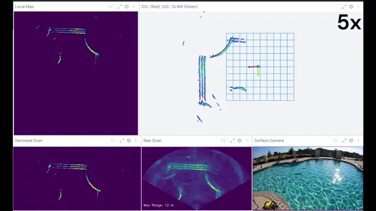
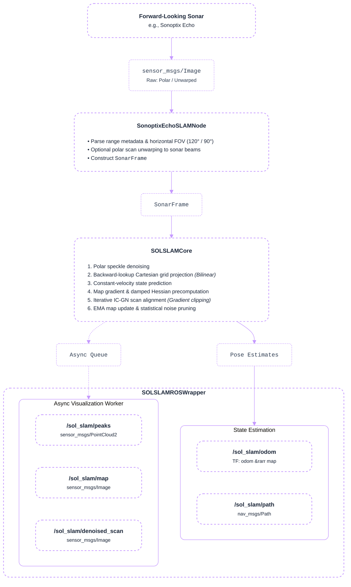

# SOL-SLAM: Fast Inverse Compositional Direct Registration for Standalone Forward-Looking Sonar

A lightweight, GPU-accelerated ROS 2 package for real-time 2D Sonar-Only Local SLAM using standalone Forward-Looking Sonar (FLS) data. Instead of relying on sparse keypoints or auxiliary sensors (DVL/IMU), SOL-SLAM directly registers full acoustic intensity scans against a recursively updated local map using an Inverse Compositional Gauss-Newton (IC-GN) formulation.



---

## Features

* **Dense Direct Alignment:** Aligns full acoustic scans to an evolving local map via normalized cross-correlation, robust to dynamic acoustic shadows and speckle.


* **Inverse Compositional Gauss-Newton:** Evaluates map gradients and the regularized Hessian once per frame, achieving real-time second-order optimization.


* **Map Maintenance:** Employs Exponential Moving Average updates combined with statistical noise decay pruning.


* **Hardware Ready:** Features an out-of-the-box frontend for the Sonoptix Echo imaging sonar.


* **Asynchronous Visuals:** Broadcasts real-time TF/Odometry alongside decoupled rendering for PointCloud2 map peaks and intensity images.

---

## System Architecture



---

## Installation & Build

1. Clone the package into your ROS 2 colcon workspace:
```bash
cd ~/ros2_ws/src
git clone https://github.com/itskalvik/sol_slam

```


2. Install ROS dependencies:
```bash
cd ~/ros2_ws
rosdep install --from-paths src --ignore-src -r -y

```


3. Compile the package:
```bash
colcon build --symlink-install --packages-select sol_slam
source install/setup.bash

```


---

## Usage

### Running with Sonoptix Echo

Launch the Sonoptix Echo SLAM node with visualizations (point cloud, denoised map, local map) enabled:

```bash
ros2 run sol_slam sonoptix_echo --ros-args \
    -p enable_debug_viz:=true

```

### Odometry Reset Service

To clear accumulated poses, velocity history, and re-initialize the local acoustic map:

```bash
ros2 service call /sonoptix_echo_slam/reset_odometry std_srvs/srv/Trigger

```

---

## ROS 2 Interface

### Subscribed Topics

| Topic | Type | Description |
| --- | --- | --- |
| `/sonar/echo/data` *(configured via `topic_in`)* | `sensor_msgs/msg/Image` | Raw mono8 acoustic scan from the sonar driver containing encoded range bits. |

### Published Topics

| Topic | Type | Frame ID | Description |
| --- | --- | --- | --- |
| `/sol_slam/odom` | `nav_msgs/msg/Odometry` | `odom_frame_id` | Estimated planar odometry ($x, y, \theta$) and twist velocities. |
| `/sol_slam/path` | `nav_msgs/msg/Path` | `odom_frame_id` | Accumulated trajectory history in the map frame. |
| `/sol_slam/peaks` | `sensor_msgs/msg/PointCloud2` | `child_frame_id` | Extracted high-intensity acoustic features (filtered for near-field artifacts > 1.0 m). |
| `/sol_slam/map` | `sensor_msgs/msg/Image` | `odom_frame_id` | Dynamically updated local Cartesian intensity map (Viridis colormap). |
| `/sol_slam/denoised_scan` | `sensor_msgs/msg/Image` | `child_frame_id` | Preprocessed, Cartesian-projected incoming acoustic frame. |

### TF Transforms

* Broadcasts `${odom_frame_id}` $\rightarrow$ `${child_frame_id}` ($SE(2)$ planar transform).

---

## Parameters & Tuning Guide

### Node & Wrapper Configuration

| Parameter | Type | Default | Description |
| --- | --- | --- | --- |
| `topic_in` | string | `/sonar/echo/data` | Sonar image input topic. |
| `odom_frame_id` | string | `odom` | Parent coordinate frame. |
| `child_frame_id` | string | `base_link` | Robot/sensor body frame. |
| `enable_debug_viz` | bool | `true` | Enables async point cloud extraction and visual map rendering. |
| `contrast` | float | `10.0` | Scaling contrast multiplier for false-color map rendering. |
| `unwarp_image` | bool | `false` | Unwarps polar-transformed sonar inputs using OpenCV `warpPolar`. |
| `enable_tensorrt` | bool | `false` | Compiles solver and map update kernels into TensorRT execution graphs. |

### SOL-SLAM Registration Parameters

Parameters map directly to the formulations detailed in the paper:

| Parameter | Type | Default | Formulation / Description |
| --- | --- | --- | --- |
| `denoise_factor` | float | `2.5` | Polar scan filtering threshold ($\beta_{\text{denoise}}$): $P \ge \mu_P + \beta_{\text{denoise}}\sigma_P$. |
| `update_alpha` | float | `0.3` | Exponential Moving Average blending factor ($\alpha$) for recursive map updates. |
| `noise_decay_factor` | float | `3.0` | Map noise decay pruning coefficient ($\beta_{\text{decay}}$): $M \ge \mu_M + \beta_{\text{decay}}\sigma_M$. |
| `iterations` | int | `15` | Maximum number of IC-GN optimization iterations per frame. |
| `lr` | float | `1.0` | Operational step size ($\gamma$) for pose updates. |
| `lm_damping` | float | `1e-3` | Levenberg-Marquardt regularizer ($\lambda$) for $H_{\text{LM}} = H + \lambda I$. |
| `max_grad_norm` | float | `10.0` | Dynamic gradient clipping ceiling ($g_{\text{max}}$) for speckle outlier rejection. |
| `min_intensity_threshold` | float | `0.0008` | Intensity threshold used for valid feature presence and PointCloud2 peak filtering. |
| `min_valid_fraction` | float | `0.006` | Minimum fraction of active sonar returns required to attempt registration. |
| `bound_factor` | float | `1.75` | Relative dynamic bounding threshold against velocity warm-start predictions. |
| `fallback_bound` | list[float] | `[0.25, 0.25, 0.08725]` | Maximum allowable single-frame displacement fallback ($[t_x, t_y, \theta]$ in meters/radians). |
| `blur_kernel_size` | list[int] | `[1, 1]` | Spatial Gaussian blur kernel applied to local map gradients. |
| `blur_sigma` | float | `0.0` | Standard deviation for map gradient Gaussian smoothing. |

---

## Citation

If you use SOL-SLAM in your research, please cite:

```bibtex
@article{sol_slam2026,
  title={SOL-SLAM: Fast Inverse Compositional Direct Registration for Standalone Forward-Looking Sonar},
  author={Kalvik Jakkala and Jason O'Kane},
  journal={arXiv preprint},
  year={2026}
}

```
